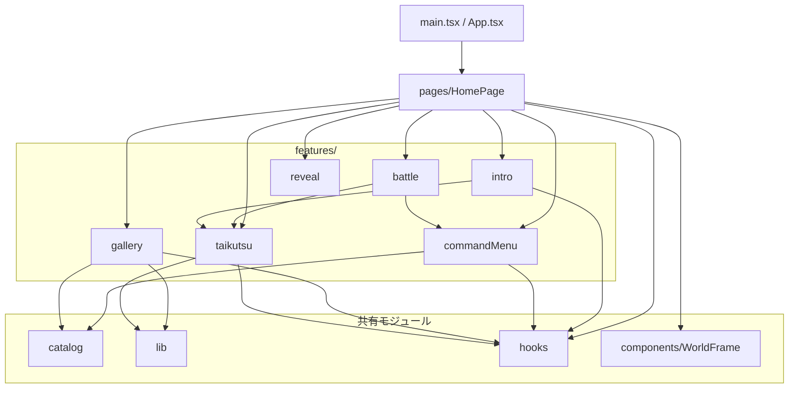
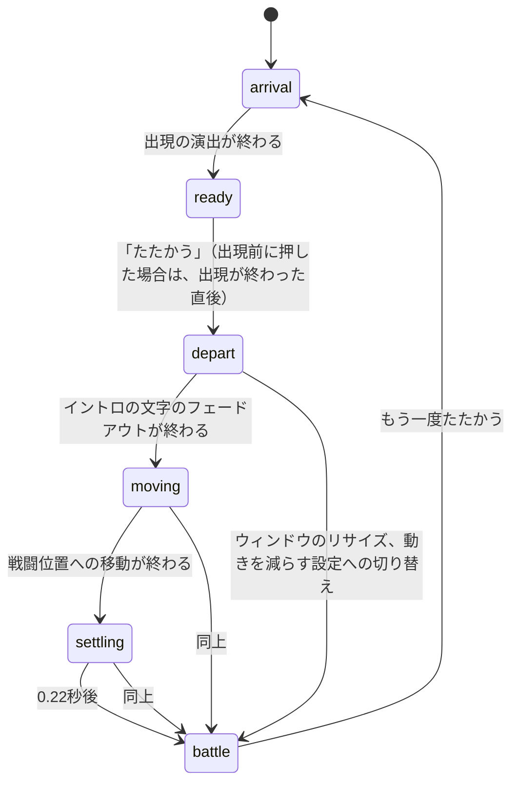
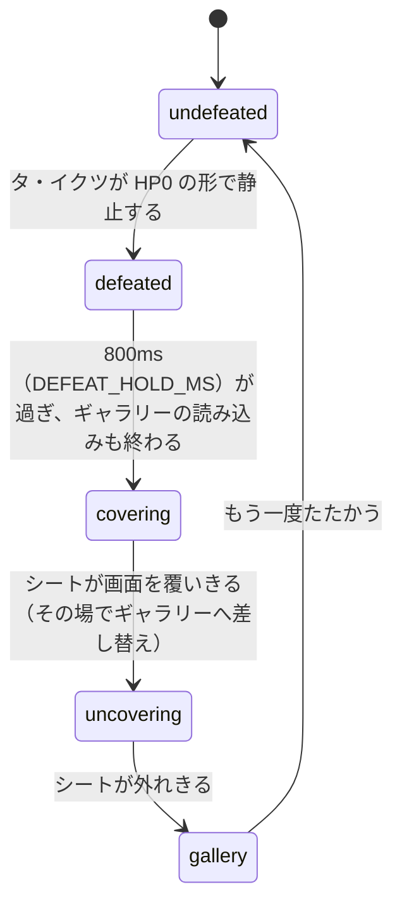
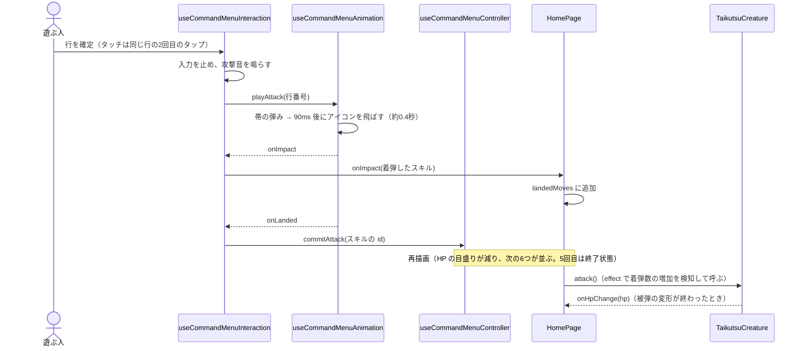
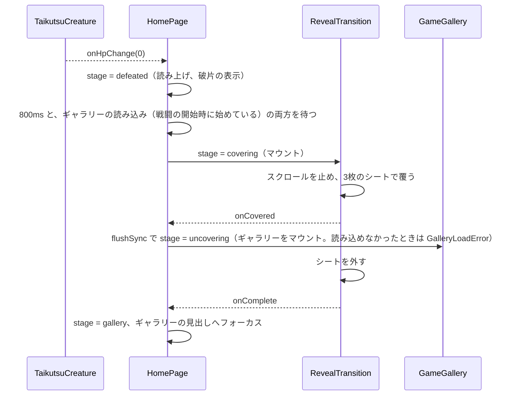

# アーキテクチャ

この文書は「退屈を、たおせ！」の実装構成（モジュールの依存関係、状態遷移、主要な処理の流れ、状態の持ち主、外部との境界、守るべき制約）を記録します。何をするアプリかは [プロダクト仕様](./product-spec)、画面ごとの振る舞いは [UX仕様](./ux-spec) を参照してください。

**目次**

- 0. 保守方針
- 1. 技術構成
- 2. モジュールの構成と依存関係
- 3. 状態遷移
- 4. 主要な処理の流れ
- 5. 状態の持ち主と外部との境界
- 6. 設計上の判断と守るべき制約

---

## 0. 保守方針

この文書は実装から自動生成されません。コードを変更したら、該当する節を同じコミット（または直後のコミット）で更新してください。

| 変更内容                                                                           | 更新する節 |
| ---------------------------------------------------------------------------------- | ---------- |
| feature（`src/features/*`）や共有モジュールを追加・削除した、import の向きを変えた | §2         |
| イントロのフェーズ（`IntroPhase`）や進行段階（`SessionStage`）を追加・変更した     | §3、§4     |
| 攻撃・撃破・画面遷移の処理の順序やタイミングを変えた                               | §4         |
| state を新たに持たせた、持ち主を移した                                             | §5.1       |
| 同梱データ、外部の画像・リンク、ブラウザ API との接点を追加・削除した              | §5.2       |
| レイアウトの基準（枠の高さ、絶対配置の基準）や、数の連動（攻撃上限など）を変えた   | §6         |

図はすべて Mermaid で書きます。GitHub 上でもこのドキュメントサイト上でもそのまま描画され、テキストの差分でレビューできるためです。

---

## 1. 技術構成

- React 19 と TypeScript で書かれた1ページの Web アプリケーションで、Vite でビルドします。ルートは `/` の1つだけです（react-router-dom、`BrowserRouter` の `basename` は Vite の `BASE_URL`）。
- アニメーションは GSAP 3（`@gsap/react` の `useGSAP`）で制御します。タ・イクツは SVG で描き、イントロで集まる粒と、タ・イクツが被弾したときに散る破片は canvas で描きます。
- 効果音は Tone.js でブラウザ内で合成します。
- 最初に読み込む JS を小さくするため、ギャラリー（推薦用のゲームのデータを含む）と Tone.js は動的 import で別のファイルに分け、必要になってから読み込みます（§5.2）。
- スタイルは CSS Modules（クラス名の有効範囲をファイルごとに分ける仕組み）で書き、共通の色などは `src/styles/tokens.css` の CSS 変数にまとめています。
- 入口は `src/main.tsx` → `src/App.tsx` → `src/pages/HomePage.tsx` です。

---

## 2. モジュールの構成と依存関係

### 2.1 ディレクトリ構成

```text
src/
  main.tsx, App.tsx            入口。ルートは / のみ
  pages/
    HomePage.tsx               画面全体の進行。各機能をつなぎ、タ・イクツを1体だけ描画する
    homeSession.ts             進行段階 SessionStage、撃破後の待ち時間、表示と読み上げのルール（純粋関数）
  features/
    intro/                     イントロ画面と、イントロから戦闘位置への移動
      components/IntroScreen   見出し・紹介文・「たたかう」ボタン
      components/IntroActor    タ・イクツ本体を包む枠（位置・出現マスク・集まる粒）
      hooks/useIntroPhase      イントロのフェーズ管理と、立ち位置の目印（dock）への移動
    battle/                    戦闘画面
      components/BattleScreen  見出し・HP表示・スキル一覧・撃破後の破片の配置。HP = 攻撃上限 − 着弾数
      components/BattleStatus  タ・イクツの名前と HP の目盛り
      components/DefeatDebris  撃破後に残る破片
    commandMenu/               スキルを選んで攻撃するメニュー
      hooks/useCommandMenuController   山札（表示中の6つ・使用済み・未表示）と攻撃回数
      hooks/useCommandMenuInteraction  カーソル、攻撃中の入力停止、タッチの2回タップ、矢印キー
      hooks/useCommandMenuAnimation    DOM の振り付け（選択帯・一覧の表示・アイコンの飛翔）とその DOM ref
      hooks/useCommandSound            効果音（Tone.js。効果音をオンにしたときに読み込む）
      lib/moves.ts                     山札から引く純粋関数と攻撃上限 ATTACK_LIMIT
    taikutsu/                  タ・イクツの描画（形・テクスチャ・被弾の変形・破片）
      data/creatureProfile.ts  肩書きと名前（イントロと戦闘の両方で表示）
    reveal/                    戦闘画面からギャラリーへの画面遷移（斜めのシート）
    gallery/                   ゲームのギャラリー（カルーセル・作品の説明・推薦）
      hooks/useLazyGameGallery ギャラリーの遅延読み込みと、その状態（読み込み中・完了・失敗）
      components/GalleryLoadError  ギャラリーを読み込めなかったときの表示
      lib/recommend.ts         推薦ロジック（純粋関数）
  catalog/                     data/*.json を読む唯一の場所と、その型
  lib/prng.ts                  決まった数列を返す乱数生成器（mulberry32）
  hooks/                       機能をまたいで使う hook（メディアクエリ、ホバー可否、動きを減らす設定、canvas のサイズ合わせ）
  components/WorldFrame/       画面の枠と背景の装飾
  test/browserStubs.ts         テスト用に、jsdom にないブラウザ API を補うスタブ
```

### 2.2 依存関係

矢印は「import する側 → される側」です。



- 機能どうしの import は、画面を組み立てる `battle` と `intro` から、部品にあたる `commandMenu` と `taikutsu` へ向かうものだけです。`gallery` と `reveal` は他の機能に依存しません。
- `pages/HomePage` は、イントロのホバー音のために `commandMenu` の効果音 hook を、タ・イクツの操作のために `taikutsu` の型を直接使います。
- JSON データを import するのは `src/catalog/` の2ファイルだけです。
- ギャラリーの本体（`gallery/components/GameGallery`。ゲームのデータを含む）と Tone.js は、動的 import で別のファイルに分けています。`HomePage` が静的に import するのは、読み込みを管理する `useLazyGameGallery` と `GalleryLoadError` だけです。

---

## 3. 状態遷移

アプリの進行は、イントロのフェーズ（`useIntroPhase` が持つ）と、撃破からギャラリーまでの進行段階（`HomePage` が持つ）の2つで表します。何を表示し何を読み上げるかは、この2つから純粋関数 `deriveSessionView`（`src/pages/homeSession.ts`）が決めます。

### 3.1 イントロのフェーズ（`IntroPhase`）



- 出現の途中で「たたかう」を押すと、出現の演出を4倍速にし、終わった直後に `depart` へ進みます。
- 動きを減らす設定のときは、`arrival` からすぐ `ready` になり、「たたかう」の後は移動の演出を省いて `battle` へ進みます。

### 3.2 進行段階（`SessionStage`）



| 段階         | 撃破済み | 画面遷移中 | ギャラリー表示 | 読み上げ                                                                                                    |
| ------------ | -------- | ---------- | -------------- | ----------------------------------------------------------------------------------------------------------- |
| `undefeated` | いいえ   | いいえ     | いいえ         | イントロ中は無し、戦闘中は「タ・イクツが現れました。…」                                                     |
| `defeated`   | はい     | いいえ     | いいえ         | 「タ・イクツを倒した。…」                                                                                   |
| `covering`   | はい     | はい       | いいえ         | 同上                                                                                                        |
| `uncovering` | はい     | はい       | はい           | 同上                                                                                                        |
| `gallery`    | はい     | いいえ     | はい           | 「タ・イクツを撃破しました。…」。ギャラリーを読み込めなかったときは「ゲームの一覧を読み込めませんでした。」 |

---

## 4. 主要な処理の流れ

### 4.1 1回の攻撃



HP にかかわる値は、意図して3つのタイミングで変わります。

1. HP の目盛り: アイコンがタ・イクツに当たった瞬間（`landedMoves` の長さ）
2. メニューの攻撃回数: 着弾の処理が終わり、次の6つを並べるとき（`commitAttack`）
3. タ・イクツの形: 被弾の変形（約0.5秒）が終わったとき（`onHpChange`）

撃破の判定には3を使い、撃破のアニメーションが実際に終わったことを合図にします。

### 4.2 撃破からギャラリーまで



### 4.3 推薦

`recommendGames`（`src/features/gallery/lib/recommend.ts`）は、着弾した順のスキルの id を受け取り、10作品を返す純粋関数です。手順と使っているデータは [開発の進め方](./development-workflow) §4 に書いています。乱数のシードを選んだスキルの集合から作るため、同じ組み合わせなら同じ結果になり、テストでもその性質を確かめています。

---

## 5. 状態の持ち主と外部との境界

### 5.1 状態の持ち主

| 状態                                            | 持ち主                                        | 生存期間                                             |
| ----------------------------------------------- | --------------------------------------------- | ---------------------------------------------------- |
| 効果音のオン/オフ                               | `HomePage`                                    | ページを開いている間（保存しない）                   |
| イントロのフェーズ                              | `useIntroPhase`                               | 同上。再戦で `arrival` に戻る                        |
| 進行段階                                        | `HomePage`                                    | 同上。再戦で `undefeated` に戻る                     |
| 着弾したスキルの配列                            | `HomePage`                                    | 同上。再戦で空に戻る                                 |
| 山札・表示中の6つ・攻撃回数                     | `useCommandMenuController`（CommandMenu 内）  | 戦闘画面が表示されている間。戦闘のたびに作り直される |
| カーソル位置・攻撃中フラグ・タッチの1回目の選択 | `useCommandMenuInteraction`                   | 同上                                                 |
| タ・イクツの形（HP の段階）                     | `useCreatureAnimation`（TaikutsuCreature 内） | ページを開いている間。再戦で `reset()`               |
| ギャラリーで正面にある作品                      | `GameGallery` / `GalleryCarousel`             | ギャラリーが表示されている間                         |
| ギャラリーの読み込みの状態                      | `useLazyGameGallery`（HomePage 内）           | ページを開いている間。読み込みは1回だけ              |

### 5.2 外部との境界

| 対象                 | 内容                                                                                                                                                                                                                             |
| -------------------- | -------------------------------------------------------------------------------------------------------------------------------------------------------------------------------------------------------------------------------- |
| 同梱データ           | `data/specialMoves.json`（スキル）と `data/gameIntros.json`（ゲームとスキルの結びつき）。`src/catalog/` だけが import する。スキルは最初の JS に含め、ゲームのデータはギャラリーのファイルに含めて、戦闘が始まったときに読み込む |
| ゲーム画像           | 外部のゲーム販売サイトの画像 URL に `?sw=880`（幅880px指定）を付けて `` で読み込む。正面と隣の作品を先に読み込み、それが済んでから残りを読み込む                                                                            |
| 販売ページへのリンク | `target="_blank" rel="noopener noreferrer"` で新しいタブに開く                                                                                                                                                                   |
| 効果音               | Tone.js（Web Audio API）でブラウザ内で合成する。音声ファイルはない。Tone.js は効果音をオンにしたときに読み込み、ユーザーの操作の後に `Tone.start()` で開始する                                                                   |
| フォントと背景画像   | `public/` に同梱。見出し用フォントは使う8文字だけのサブセット。背景は OpenStreetMap をもとにした画像（グレースケール4階調の可逆圧縮 WebP。横並び用に幅 1400px、縦積み用に幅 1000px）で、表示中はクレジットを出す                 |
| 保存                 | localStorage・Cookie などには何も保存しない。再読み込みで最初から始まる                                                                                                                                                          |
| 配信                 | `main` への push で GitHub Actions（`.github/workflows/deploy-pages.yml`）がアプリを `/taikutsu/`、このドキュメントを `/taikutsu/docs/` として GitHub Pages へデプロイする                                                       |

---

## 6. 設計上の判断と守るべき制約

### 6.1 設計上の判断

- 構成は機能ごとのフォルダに分けるだけにしています。実質1画面のアプリなので、層を重ねた構成にはしていません。機能どうしの依存の向きは §2.2 のとおりです。
- 進行の状態は、イントロのフェーズと進行段階の2つに分けています。イントロのフェーズは GSAP の移動の演出と密に結びついているため `useIntroPhase` が持ち、撃破からギャラリーまでの進行は `HomePage` が `SessionStage` 1つで持ちます。表示と読み上げはこの2つから導き、別の state として持ちません。
- タ・イクツの被弾は、React の状態に合わせて命令的なアニメーションを動かす形にしています。着弾は `landedMoves` に記録し、その長さが増えたことを effect で検知して `attack()` を呼びます。
- スキル一覧の操作と振り付けを分けています。`useCommandMenuInteraction` は DOM に触れず、カーソルや攻撃中のロックといった操作のルールだけを扱い、行番号で `useCommandMenuAnimation` に指示します。DOM の ref は、それを直接操作する `useCommandMenuAnimation` が持ちます。

### 6.2 守るべき制約

- タ・イクツは `HomePage` で1体だけ描画します。各画面は立ち位置の目印（`creatureDockRef`）だけを持ちます。画面の中で描画すると切り替えのたびに再マウントされ、呼吸の動きやテクスチャが途切れます。
- 戦闘画面のセクションは `position: static` のままにします（`src/pages/HomePage.module.css` の `.battleSection`）。見出しと HP の列は枠（World Container）を基準に絶対配置され、`useIntroPhase` も同じ要素を基準に目印の位置を測っています。
- 横並びの戦闘画面では、スキル一覧だけを通常の配置（下寄せ）にします（`.battleWorld` と `src/features/battle/components/BattleScreen.module.css` の `.commandAnchor`）。一覧が既定の高さに収まらないときは枠を下へ伸ばし、枠の上端は既定の高さで縦中央に置いたときの位置に固定します。HP の列は、枠の実際の高さではなく既定の高さ `--world-default-height`（`src/components/WorldFrame/WorldFrame.module.css`）を基準に置くので、枠が伸びてもタ・イクツは動きません。一覧を絶対配置にすると、横に広いわりに背の低い画面で枠の上へはみ出します。
- `RevealTransition` の `onCovered` の中では、ギャラリーへの差し替えを `flushSync` で同期的に commit します。シートはこの呼び出しが戻った直後に外れ始めます。
- 「5」という数はまとめて変えます。攻撃上限 `ATTACK_LIMIT`（`src/features/commandMenu/lib/moves.ts`）、タ・イクツの形の段階 `HP_SHAPES`（`src/features/taikutsu/lib/shapeStates.ts`、HP5〜0）、推薦の strong-tie 枠 `STRONG_TIE_TARGET`（`src/features/gallery/lib/recommend.ts`）、イントロの文言「スキルを5つ選んで」（`src/features/intro/data/introCopy.ts`）、当たった音の5段階（`src/features/commandMenu/hooks/useCommandSound.ts`）は連動しています。このうち `ATTACK_LIMIT` と `HP_SHAPES` の一致は `src/features/battle/hpInvariant.test.ts` で確かめています。ほかの3つの一致はテストしていません。
- 着弾が1つ増えるごとに `attack()` を1回呼びます。`attack()` は前の被弾の変形が再生中ならそれを最後まで進めてから次を始めるので、呼んだ回数だけ HP が1段階ずつ進みます。
- フォーカスの移動先の id（`intro-battle-title`、`gallery-heading-title`）と、スクロールを止める対象の目印 `data-scroll-root` は変えません。`HomePage` と `RevealTransition` が参照しています。`GalleryLoadError` の見出しも、ギャラリーと同じ `gallery-heading-title` にしています。
- `HomePage.module.css` は `WorldFrame` より後に読み込みます。`.galleryWorld` と `.battleWorld` は枠の高さと配置を上書きするため、CSS の順序に依存しています（`HomePage.tsx` の import の順で決まります）。
- データの整合性を保ちます。`relatedMoves` の `moveId` は `data/specialMoves.json` に存在する必要があります（ないと推薦時に例外）。各スキルの id には `src/features/commandMenu/data/moveIcons.tsx` のアイコンが必要です（ないと読み込み時に例外）。
- 見出しの文言を変えたら、フォントのサブセットを作り直します（`src/index.css` のコメント参照）。
- `tone` と `GameGallery` は静的に import しません。最初の JS に入ると、Tone.js の読み込み時の処理が長いタスクになり、ゲームのデータが JS を大きくします（[品質目標](./quality-targets) §3）。
- 撃破の後の画面遷移は、ギャラリーの読み込みが終わってから始めます（`HomePage` の `defeated` の effect）。シートが外れたあとにギャラリーがまだない、という状態を作らないためです。
- 補助的な小さい文字の色には `--color-ink-muted`（`src/styles/tokens.css`）を使います。紙色の背景でコントラスト比 4.5:1 以上を保つ値です。
- 攻撃のあとスキル一覧の先頭の行へフォーカスを戻すのは、攻撃中のロックが解けて行のボタンが有効に戻ってからです（`useCommandMenuInteraction`）。無効なボタンにはフォーカスできません。
- ギャラリーの正面のカードはリンク、それ以外のカードはボタンとして描くため、作品を切り替えるとカードの要素が作り直されます。カードにフォーカスがあった切り替えでは、`GalleryCarousel` が新しい正面のカードへフォーカスを移します。
- 本番ビルドと `vite preview` のパスは `/taikutsu/` です（`vite.config.ts`）。ドキュメントサイトは `/taikutsu/docs/` です（`docs/.vitepress/config.ts`）。
- `useGSAP` の `contextSafe()` は呼ぶたびに新しい関数を返します。これに依存する effect は毎レンダー再実行されます（今はリサイズ時の帯の補正の購読がこれに当たります）。ループし続けるアニメーションは、この種の関数に依存させないでください。
