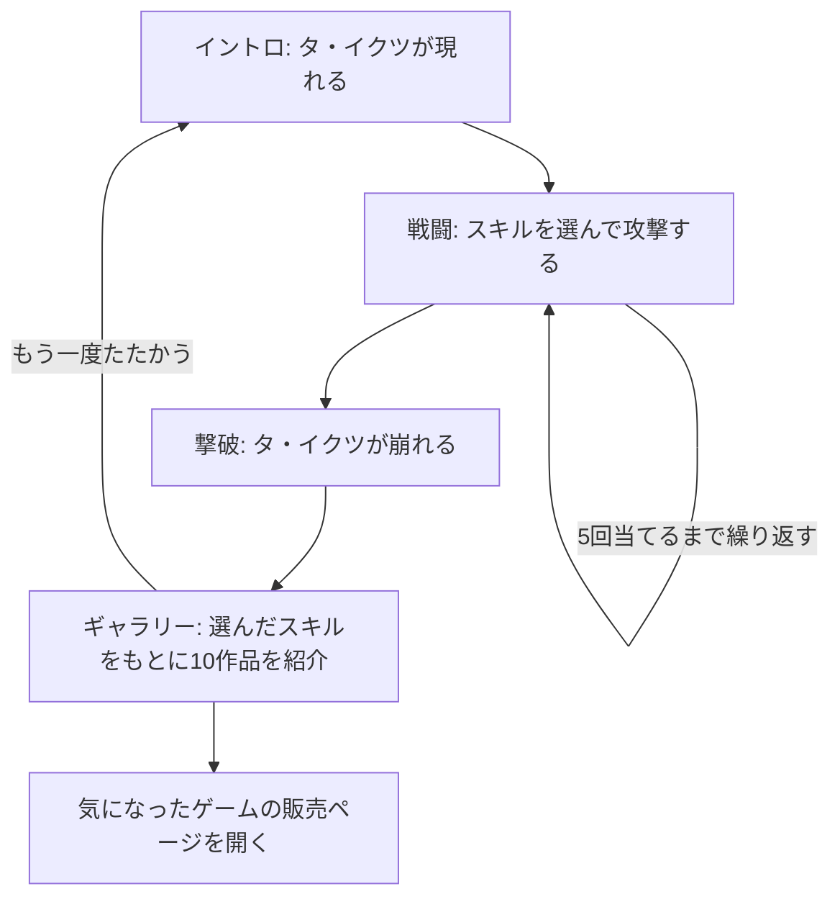

# プロダクト仕様

固有名詞と用語の扱いは [用語集](./glossary) を参照してください。画面ごとの振る舞いは [UX仕様](./ux-spec) にあります。

## 1. 目的

「退屈を、たおせ！」は、ゲームのタイトルやジャンルから探すのとは違う、ゲームとの新しい出会い方を提供する Web アプリケーションです。コンセプトは「退屈を倒して、まだ知らない遊びに出会う」です。

このアプリでは、遊ぶ人が興味を持つゲーム体験を「スキル」として表します。スキルを選んで敵の「タ・イクツ」を倒すと、選んだ体験に結びつくゲームが見つかります。ゲームを探す行為そのものを遊びに変えることで、普段は選ばないジャンルや、これまで知らなかった作品に興味を持つきっかけをつくります。

最終的なゴールは、戦闘の演出を楽しんでもらうことだけでなく、紹介されたゲームに興味を持ち、「実際に遊んでみたい」と感じてもらうことです。

## 2. 対象と体験

主な対象は子どもですが、大人も楽しめる体験を想定しています。特に、遊びたいゲームが決まっていない人や、普段は選ばないジャンルの作品にも出会いたい人に向けています。

スキルは、ゲームのジャンルやタイトルではなく、「どんな遊びを体験したいか」という感覚で選びます。たとえば「シャドウステップ（気配を消して敵の目をすり抜け、見つからずに切りぬける。）」や「ワンモアトライ（失敗しても『もう一回！』と何度でも挑み、少しずつ上手くなる。）」のように、ジャンルの違うゲームにも共通する体験を選択肢として示します。

退屈を倒した結果として、選んだスキルに結びつくゲームと出会います。目指しているのは、「ゲームを探していたわけではないのに、遊んでいたら気になるゲームが見つかった」という体験です。

## 3. 中心となる流れ

アプリにある流れはこの1つだけで、画面はこの順に1つのページの中で切り替わります。

## 4. 主な機能

| 機能                     | 内容                                                                                                                                                                                                                                       |
| ------------------------ | ------------------------------------------------------------------------------------------------------------------------------------------------------------------------------------------------------------------------------------------ |
| イントロ                 | 粒が集まってタ・イクツが現れ、「たたかう」で戦闘を始めます。                                                                                                                                                                               |
| スキルの選択と戦闘       | 全27種類のスキルから、常に6つを表示します。1つ選ぶとタ・イクツに攻撃が当たり、HP が1減ります。5回当てると倒せます。「ほかのスキルを見る」で、攻撃の回数を使わずに6つを入れ替えられます。使ったスキルは同じ戦闘の中では二度と出てきません。 |
| 撃破と画面の切り替え     | タ・イクツが崩れたあと、シートが画面を覆い、ギャラリーへ切り替わります。                                                                                                                                                                   |
| ギャラリー               | 選んだ5つのスキルをもとに10作品を紹介します。最大5作品は選んだスキルと強く結びつくゲームで、残りは選んだどのスキルとも強くは結びつかないゲームです。同じ5つのスキルを選べば、選んだ順番に関係なく同じ10作品が同じ並びで出ます。            |
| 販売ページへのリンク     | 紹介したゲームの販売ページ（外部のゲーム販売サイト）を新しいタブで開けます。                                                                                                                                                               |
| 効果音                   | 初期状態ではオフです。画面右下のボタンで切り替えます。                                                                                                                                                                                     |
| 動きを減らす設定への対応 | 端末の設定で動きを減らしている場合は、大きな動きを省いた表示に切り替えます。                                                                                                                                                               |

推薦の決め方とデータの作り方は [開発の進め方](./development-workflow) §4 にまとめています。

## 5. やらないこと

### スコア・ランキング

遊ぶ人どうしの競争や、選んだスキルの優劣ではなく、ゲームとの出会いを重視しています。そのため、攻撃の威力の差、失敗、スコアを設けず、誰もが最後まで体験できる設計にしています。どのスキルで攻撃しても HP は1ずつ減り、負けることはありません。

### 検索・絞り込みを中心としたゲーム探し

タイトルやジャンルなどの条件を指定してゲームを探すのではなく、体験を起点として、まだ知らないゲームを見つけることを重視しています。
